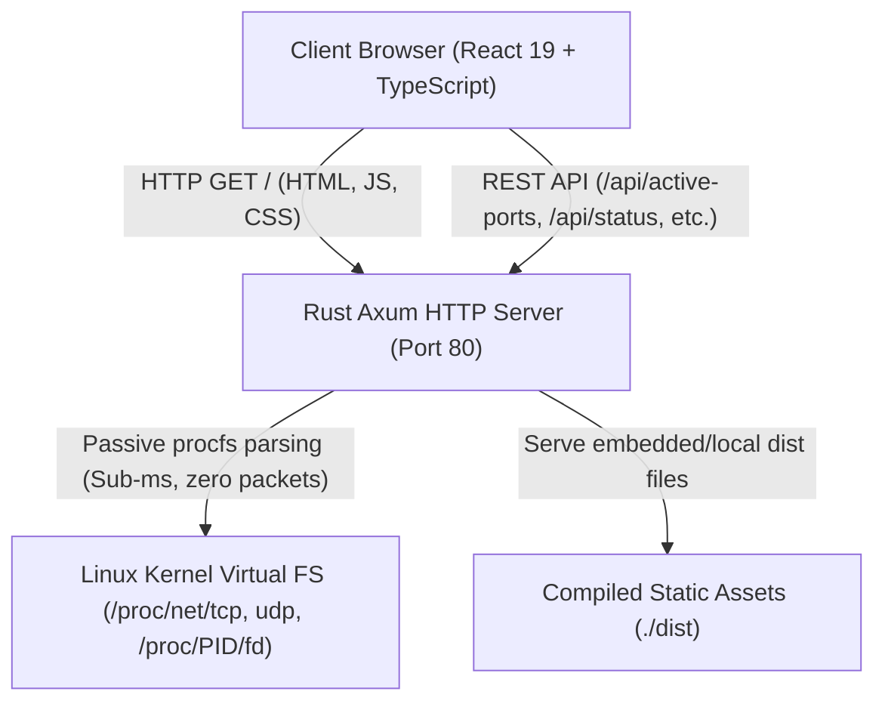

# 🏗️ Technical Architecture & Internal Mechanics

> **Document:** `docs/ARCHITECTURE.md`  
> **Classification:** System Design & Codebase Structure  
> **Audience:** Core Maintainers, Developers, Technical Architects  

---

## 1. What is this Document?

This document outlines the internal architecture, kernel socket inspection mechanics, single-binary distribution strategy, and strict **~200 lines per file** modular layout of **Port Inventory**.

---

## 2. High-Level System Architecture

Port Inventory is designed as a hybrid fullstack application combining:
- A high-speed, zero-dependency **Rust backend** (Axum, Tokio).
- A modern, reactive **TypeScript/React frontend** (Vite, Bun, Biome).
- A direct **Linux Procfs Kernel Bridge** for non-intrusive socket inspection.



---

## 3. Passive Kernel Procfs Inspection Mechanics

Unlike traditional network scanners (e.g. Nmap) that inject network packets into network interfaces, Port Inventory operates **100% passively**:

1. **Socket Table Ingestion**:
   - Reads `/proc/net/tcp` and `/proc/net/tcp6` for IPv4/IPv6 TCP sockets.
   - Reads `/proc/net/udp` and `/proc/net/udp6` for UDP sockets.
   - Parses hex-encoded IP endpoints (`0100007F:0050` -> `127.0.0.1:80`) and socket states (`0A` -> `LISTEN`).

2. **Socket Inode Resolution**:
   - The kernel assigns a unique integer `inode` to every active socket.
   - The scanner iterates over `/proc/[pid]/fd/*` symlinks matching `socket:[<inode>]`.
   - When an inode matches, the scanner associates the owning **Process ID (PID)**.

3. **Process Metadata & File Attribution**:
   - `/proc/[pid]/comm`: Reads executable / daemon name.
   - `/proc/[pid]/cmdline`: Parses command line arguments, runtime scripts, and configuration paths.
   - `/proc/[pid]/exe`: Reads symlink to binary executable on disk.
   - `/proc/[pid]/cwd`: Resolves working directory and detects project entrypoints (e.g. `server.js`, `package.json`).
   - Command-line port extraction (e.g. `docker-proxy -host-port <p> -container-port <cp>`).

4. **Service Correlation**:
   - Cross-references the detected port against the built-in IANA standard database (`src/reserved_db.rs`) to report whether the service is expected or rogue.

---

## 4. REST API Endpoint Contracts

| Route | Method | Description | Response Type |
| :--- | :--- | :--- | :--- |
| `/api/status` | `GET` | Hostname, kernel release, uptime, listening count, bound port | `SystemStats` |
| `/api/active-ports` | `GET` | All live active listening sockets, app names, file paths, and PIDs | `Vec<ActivePort>` |
| `/api/reserved-ports` | `GET` | IANA catalog with host availability indicators | `Vec<ReservedPort>` |
| `/api/inspect/:port` | `GET` | Single port deep-dive, active bindings, alternative ports | `PortDetail` |
| `/api/custom-names` | `GET` | User-defined port custom names / aliases map | `HashMap<u16, String>` |
| `/api/custom-names/:port` | `PUT` | Assign or update custom alias for a port | `StatusCode 200` |
| `/api/custom-names/:port` | `DELETE` | Delete custom alias for a port | `StatusCode 200` |

---

## 5. Modular Codebase Layout

To maintain exceptional code quality and prevent monolithic sprawl, every source file begins with a self-documenting explanation header:

```
port-inventory/
├── src/
│   ├── main.rs                 # Port 80 supervisor & shutdown hooks (~170 lines)
│   ├── server.rs               # Axum REST controllers & SPA asset router (~190 lines)
│   ├── scanner.rs              # Linux procfs passive socket & file attribution (~560 lines)
│   ├── reserved_db.rs          # IANA system & registered port registry (~176 lines)
│   ├── telemetry.rs            # Host telemetry & diagnostic metrics (~50 lines)
│   └── models.rs               # Strongly-typed data structs and enums (~210 lines)
├── client/src/
│   ├── main.tsx                # React mount point & global error boundary (~153 lines)
│   ├── App.tsx                 # Main dashboard shell & telemetry polling (~215 lines)
│   ├── types.ts                # TypeScript domain contracts & utilities (~185 lines)
│   ├── hooks/
│   │   └── useCustomNames.ts   # Custom port aliases & offline sync hook (~140 lines)
│   ├── context/ThemeContext.tsx# 9-theme state manager & localStorage sync (~195 lines)
│   ├── components/
│   │   ├── ActivePortsTable.tsx    # Live listening socket, app & file table (~380 lines)
│   │   ├── ReservedPortsList.tsx   # IANA catalog & availability filter (~262 lines)
│   │   ├── PortInspectorModal.tsx  # Deep single-port diagnostic & file details (~360 lines)
│   │   ├── ThemeSelector.tsx       # Swatch picker for all 9 palettes (~239 lines)
│   │   └── WarningBanner.tsx       # Security disclaimer & capabilities note (~214 lines)
│   └── styles/
│       ├── themes.css          # CSS design tokens for 9 visual palettes (~242 lines)
│       └── globals.css         # Modern responsive reset & table styling (~262 lines)
├── biome.json                  # Biome 2.6.4 formatter and linter config
├── vite.config.ts              # Vite bundling config
└── Cargo.toml                  # Rust dependencies (Axum, Tokio, Tower-Http)
```

---

## 6. Build & Compilation Pipeline

1. **Frontend Compilation**:
   ```bash
   bun run build
   ```
   Compiles TypeScript and bundles CSS into optimized static assets in `./dist`.

2. **Backend Compilation**:
   ```bash
   cargo build --release
   ```
   Compiles native Rust binary `./target/release/port-inventory`.

3. **Combined Deployment Script**:
   ```bash
   bun run deploy
   ```
   Builds both frontend and backend in a single pipeline.
