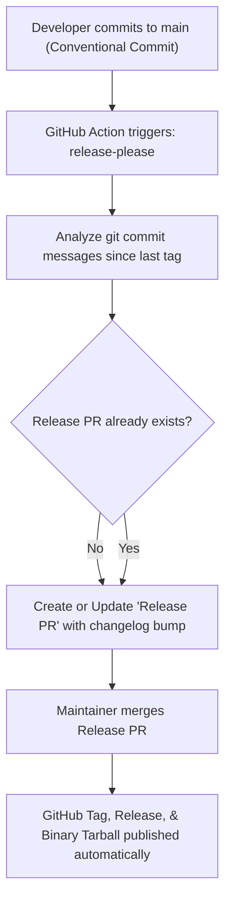

# 🚀 Trunk-Based Development & Release-Please Workflow

> **Document:** `docs/TRUNK_BASED.md`  
> **Classification:** CI/CD & Development Workflow  
> **Audience:** Contributors, Maintainers, DevOps  

---

## 1. What is this Document?

This document defines the **Trunk-Based Development** workflow and automated release management via **Google's Release Please** adopted by the **Port Inventory** project.

---

## 2. What is Trunk-Based Development?

Trunk-Based Development (TBD) is a branching model where all developers merge small, frequent updates directly into a single central branch called **`main`** (the "trunk").

### Core Rules of Trunk-Based Development:
1. **Single Source of Truth**: The `main` branch is always stable, releasable, and tested.
2. **Short-Lived Branches**: Feature branches live for hours or days, not weeks.
3. **Continuous Integration**: Every push to `main` executes automated validation (linting, type checking, tests).
4. **No Gitflow Overhead**: We eliminate long-running `develop`, `release/*`, or `hotfix/*` branches.

---

## 3. Automated Releases with Release Please

To automate versioning and changelog maintenance on `main`, we use **Google's `release-please`** via GitHub Actions (`.github/workflows/release-please.yml`).

### How It Works:


---

## 4. Conventional Commits Specification

Release Please inspects commit messages to determine semantic version bumps (**Major**, **Minor**, **Patch**):

| Commit Type | SemVer Impact | Description | Example |
| :--- | :--- | :--- | :--- |
| `fix:` | **Patch** (`0.0.X`) | Bug fixes and patches | `fix: handle ipv6 address formatting in procfs scanner` |
| `feat:` | **Minor** (`0.X.0`) | New features and capabilities | `feat: add oled-mono-duo theme palette` |
| `feat!:` or `BREAKING CHANGE:` | **Major** (`X.0.0`) | Breaking changes | `feat!: restructure api response for socket status` |
| `docs:` | None | Documentation updates | `docs: split monolithic readme into modular guides` |
| `perf:` | **Patch** (`0.0.X`) | Performance optimizations | `perf: cache socket inode lookup table` |
| `refactor:` | None / Patch | Code refactoring | `refactor: split server routes into separate modules` |
| `chore:` | None | Tooling, dependencies, CI | `chore: update biome to version 2.6.4` |

---

## 5. Configuration Files in this Repository

### 1. `release-please-config.json`
Specifies package details, release type, and files to update during release:
```json
{
  "$schema": "https://raw.githubusercontent.com/googleapis/release-please/main/schemas/config.json",
  "packages": {
    ".": {
      "release-type": "rust",
      "package-name": "port-inventory",
      "changelog-path": "CHANGELOG.md",
      "bump-minor-pre-major": false,
      "bump-patch-for-minor-pre-major": false,
      "extra-files": [
        "Cargo.toml",
        "package.json"
      ]
    }
  }
}
```

### 2. `.release-please-manifest.json`
Tracks the current released version:
```json
{
  ".": "1.0.0"
}
```

### 3. `.github/workflows/release-please.yml`
Runs automatically on every push to `main`:
1. Executes `googleapis/release-please-action@v4`.
2. When a Release PR is merged, builds the web assets and native Rust binary.
3. Packages the release into `port-inventory-linux-x86_64.tar.gz`.
4. Uploads the compressed binary directly to the GitHub Release.

---

## 6. How to Contribute a Change

1. Ensure your local branch is up to date:
   ```bash
   git pull origin main
   ```
2. Make your modular changes (keeping files ~200 lines).
3. Validate code quality:
   ```bash
   bun run check      # Biome linter & formatter
   bun run build      # Frontend build check
   cargo check        # Backend Rust check
   ```
4. Commit using a Conventional Commit message:
   ```bash
   git commit -m "feat: add quick search keyboard shortcut"
   ```
5. Push directly to `main` (or open a short-lived PR to `main`):
   ```bash
   git push origin main
   ```
Release Please will automatically update the pending Release PR with your changelog entry.
